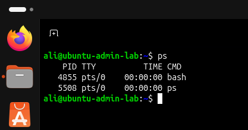
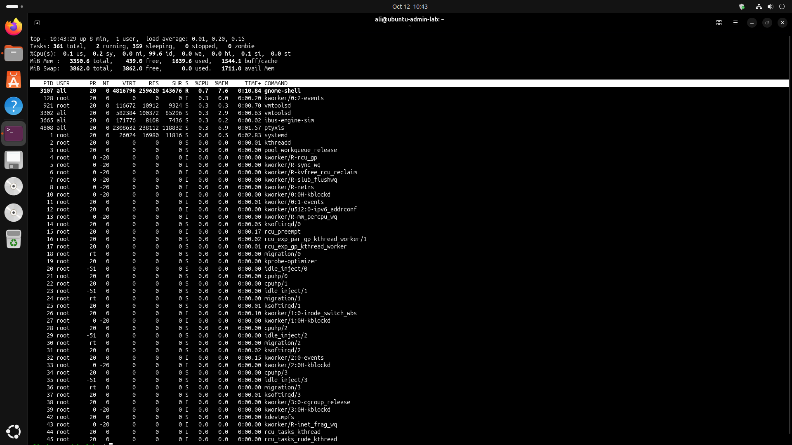
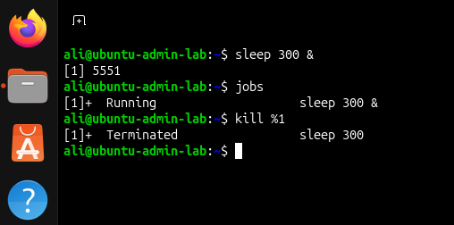
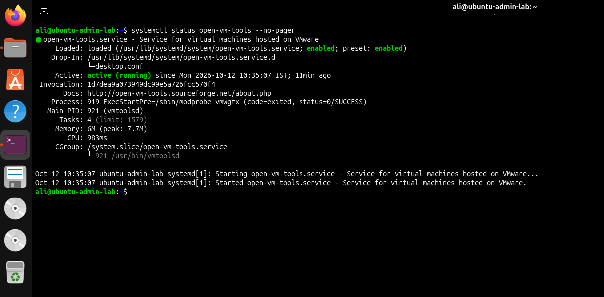
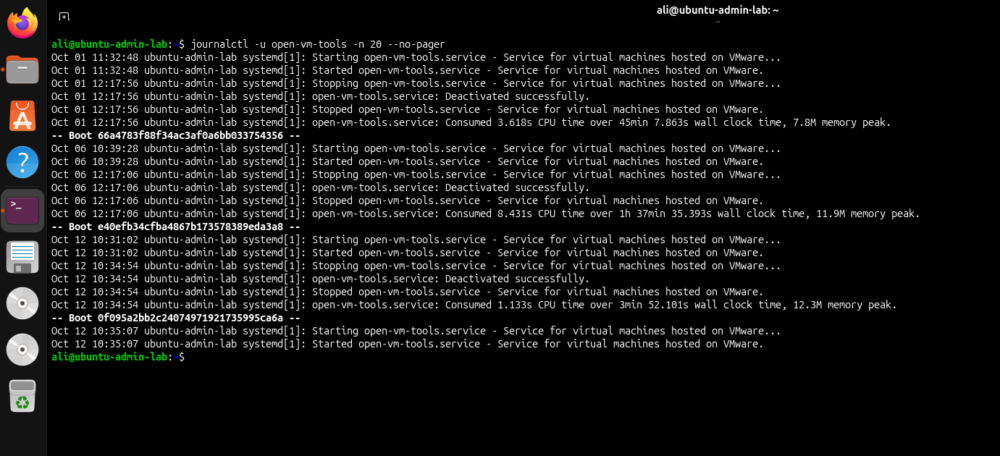

# Phase 3 — Processes and Services

## Objective

Implement and document Linux process monitoring, background job management, systemd service inspection, and system log analysis in Ubuntu.

## Environment

- OS: Ubuntu
- Virtualization: VMware
- Service examined: `open-vm-tools`

## 1. Process Management

Used `ps` to inspect terminal processes and `top` to monitor active processes and system resource usage.

### Tasks
- Inspected running processes.
- Monitored CPU and memory usage.
- Started a background test process using `sleep`.
- Listed background jobs using `jobs`.
- Terminated the test job using `kill %1`.

## 2. Service Management

Inspected the VMware Tools service:

```bash
systemctl status open-vm-tools --no-pager
```

### Results
- The service was loaded and enabled.
- The service was active and running during verification.
- Inspected the main process and service resource information.

## 3. Log Analysis

Reviewed recent service logs:

```bash
journalctl -u open-vm-tools -n 20 --no-pager
```

### Results
- Reviewed service startup and shutdown events.
- Identified service activation and deactivation messages.
- Used journal entries to inspect service activity.

## Screenshots

### Process List


### Resource Monitoring


### Background Job Management


### Service Management


### Log Analysis


## Outcome

Completed practical exercises covering process inspection, resource monitoring, background jobs, systemd service verification, and service log analysis.

## Tools Used

`ps`, `top`, `sleep`, `jobs`, `kill`, `systemctl`, `journalctl`
