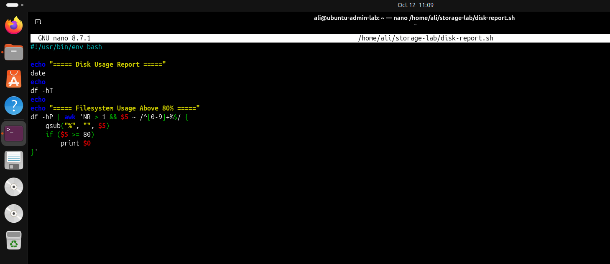
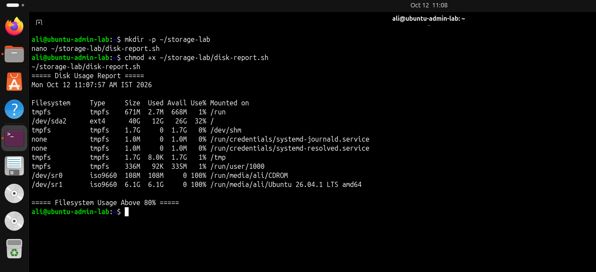

# Phase 4 — Storage Management

## Objective

Implement a reusable Bash script to monitor filesystem capacity and identify filesystems reaching a defined usage threshold.

## Environment

- Operating System: Ubuntu
- Virtualization: VMware
- Script Language: Bash

## Implementation

Created `disk-report.sh` to generate a timestamped disk usage report and identify filesystems with usage at or above 80%.

The script uses `df -hT` to display filesystem types, capacity, used space, available space, usage percentage, and mount points.

### Script

```bash
#!/usr/bin/env bash

echo "===== Disk Usage Report ====="
date
echo
df -hT
echo
echo "===== Filesystem Usage Above 80% ====="
df -hP | awk 'NR > 1 && $5 ~ /^[0-9]+%$/ {
    gsub("%", "", $5)
    if ($5 >= 80)
        print $0
}'
```

## Execution

Made the script executable and ran it:

```bash
chmod +x ~/storage-lab/disk-report.sh
~/storage-lab/disk-report.sh
```

## Results

- Generated a timestamped filesystem usage report.
- Displayed filesystem capacity and usage in a readable format.
- Added a threshold check to flag filesystems at or above 80% usage.
- Verified that the root filesystem was using approximately 32% of its capacity during the captured run.

## Screenshots

### Disk Report Script



### Storage Usage Report



## Outcome

Implemented a reusable disk usage reporting script with filesystem capacity reporting and threshold-based usage detection.

## Tools Used

`Bash`, `df`, `date`, `awk`, `chmod`
