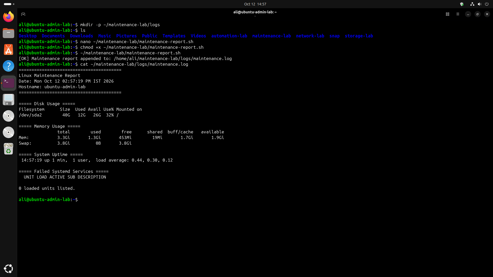
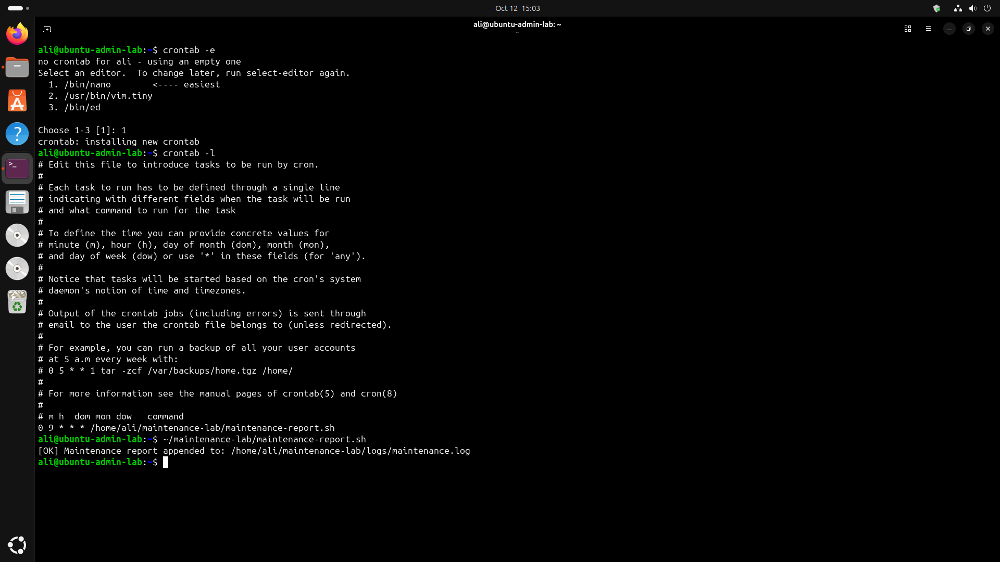

# Phase 7: Scheduling and Maintenance

## Overview

This phase implements a scheduled Linux maintenance report using Bash scripting and cron. The script collects essential system health information and appends each report to a persistent log file.

## Objectives

- Automate routine system health reporting.
- Monitor disk and memory usage.
- Record system uptime and failed systemd services.
- Maintain a persistent log of report executions.
- Schedule recurring maintenance using cron.

## Script Implemented

**`maintenance-report.sh`**

The script collects the following information:

- Date and hostname
- Root filesystem usage
- Memory and swap usage
- System uptime and load averages
- Failed systemd services

Report output is appended to `maintenance.log`, preserving previous reports.

## Execution

Run the script manually:

```bash
~/maintenance-lab/maintenance-report.sh
```

Expected confirmation:

```text
[OK] Maintenance report appended to: /home/ali/maintenance-lab/logs/maintenance.log
```

## Maintenance Report

The generated report records disk capacity, memory utilization, uptime, and failed systemd services.



## Scheduled Execution

A user-level cron job was configured to run the maintenance script daily at 9:00 AM.

```cron
0 9 * * * /home/ali/maintenance-lab/maintenance-report.sh
```

The schedule was verified using `crontab -l`, and the script was executed manually to confirm successful operation.



## Skills Demonstrated

- Bash scripting
- Linux system monitoring
- Cron job scheduling
- Log management
- Automated maintenance
- Verification and troubleshooting

## Outcome

Implemented a scheduled maintenance reporting workflow that collects essential Linux system health information and maintains a persistent log for review.
